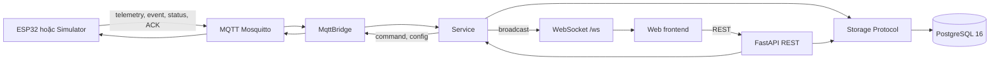
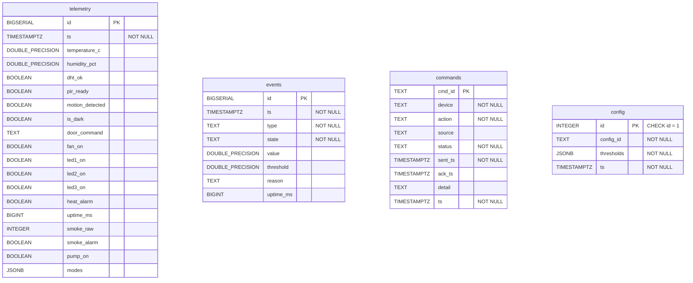

# Thiết kế cơ sở dữ liệu – phần Database & History

## 1. Phạm vi và nguồn đối chiếu

Tài liệu này mô tả thiết kế đang có trong mã nguồn, chủ yếu dựa trên:

- `backend/app/pg_storage.py`: hằng `SCHEMA`, lớp `PostgresStorage` và các câu SQL đọc/ghi;
- `backend/app/storage.py`: `Storage`, `InMemoryStorage`, danh sách metric và validation lịch sử;
- `backend/app/models.py`: mô hình dữ liệu nhận từ MQTT và validation nghiệp vụ;
- `backend/app/service.py`: lớp `Service`, nơi gắn thời gian nhận và gọi Storage;
- `backend/app/mqtt_bridge.py`, `backend/app/api.py`, `backend/app/main.py`: đường đi MQTT, REST và WebSocket;
- `docker-compose.yml`: PostgreSQL 16 và volume `pgdata`.

Các mục ghi “đề xuất” chưa phải là chức năng đã triển khai.

## 2. Kiến trúc dữ liệu hiện tại



Luồng nhận dữ liệu cụ thể:

1. `MqttBridge.handle_message()` định tuyến topic đến `Service.on_telemetry()`, `on_event()`, `on_status()`, `on_cmd_ack()` hoặc `on_config_ack()`.
2. `Service.on_telemetry()` và `Service.on_event()` kiểm tra payload bằng model Pydantic, lấy thời gian nhận từ `clock()` rồi gọi `save_telemetry()` hoặc `save_event()`.
3. Khi có `BTL_DATABASE_URL`, `backend/app/main.py` tạo `PostgresStorage`; nếu không có, hệ thống dùng `InMemoryStorage`.
4. `PostgresStorage` đổi Unix timestamp giây sang `TIMESTAMPTZ` bằng `to_timestamp()` khi ghi và đổi ngược bằng `extract(epoch from ...)::float8` khi đọc.
5. API hiện hành đọc lịch sử qua `Storage.history()` tại `GET /api/history`. Telemetry và các thay đổi trạng thái khác còn được `Service` phát trực tiếp qua WebSocket.

### Dữ liệu lưu bền và trạng thái runtime

| Luồng | Dữ liệu được lưu trong PostgreSQL | Phần chỉ tồn tại ở runtime |
|---|---|---|
| Telemetry MQTT | Một hàng `telemetry` cho mỗi payload hợp lệ; gồm cảm biến, trạng thái thiết bị, `modes`, `uptime_ms` và `ts` do backend gắn | Telemetry mới nhất trong `Service._telemetry` và trạng thái kết nối hiện hành |
| Event MQTT | Mỗi payload event hợp lệ thành một hàng `events`; `state` là `start` hoặc `end` | Không có trạng thái event tổng hợp riêng trong Service |
| Command và command ACK | Lệnh được ghi `pending` trước khi publish; ACK hoặc timeout cập nhật chính hàng `commands` qua `status`, `detail`, `ack_ts` | Không có hàng ACK riêng |
| Config và config ACK | Bảng `config` chỉ lưu `config_id`, `thresholds`, `ts` của cấu hình mới nhất | `pending`, `applied`, `rejected`, `timeout`, `detail` và thời điểm chờ ACK nằm trong `Service._config` |
| MQTT status/timeout kết nối | Không có bảng hoặc cột lưu online/offline | `_online`, `_last_seen`, `_offline_since`; được phát qua WebSocket |

Vì vậy “đã nhận ACK” không đồng nghĩa mọi loại ACK đều được lưu giống nhau: command ACK làm thay đổi hàng `commands`, còn config ACK chỉ thay đổi trạng thái runtime. Event là bản tin nghiệp vụ độc lập, không phải ACK.

## 3. ERD vật lý hiện tại

Schema được khai báo trong `backend/app/pg_storage.py` tại hằng `SCHEMA`. Bốn bảng không có khóa ngoại và không có quan hệ vật lý được khai báo. Vì vậy ERD dưới đây chỉ biểu diễn cấu trúc từng bảng, không vẽ quan hệ suy diễn.



### Chỉ mục và constraint

| Bảng | Khóa/constraint | Chỉ mục tường minh |
|---|---|---|
| `telemetry` | `PRIMARY KEY (id)`; `ts NOT NULL` | `telemetry_ts_idx (ts)` |
| `events` | `PRIMARY KEY (id)`; `ts`, `type`, `state` là `NOT NULL` | `events_ts_idx (ts)` |
| `commands` | `PRIMARY KEY (cmd_id)`; `device`, `action`, `status`, `sent_ts`, `ts` là `NOT NULL` | `commands_sent_idx (sent_ts)` |
| `config` | `PRIMARY KEY (id)`; `CHECK (id = 1)`; `config_id`, `thresholds`, `ts` là `NOT NULL` | Không có chỉ mục tường minh ngoài chỉ mục do PK tạo |

PostgreSQL tự tạo chỉ mục duy nhất để thực thi `PRIMARY KEY`; bảng không có `UNIQUE`, `FOREIGN KEY` hay `CHECK` nào khác trong source hiện tại.

## 4. Khởi tạo và lưu bền

`PostgresStorage.__init__()` mở `ConnectionPool` với `autocommit=True`, chờ database sẵn sàng rồi thực thi toàn bộ `SCHEMA`. Các lệnh đều dùng `CREATE TABLE IF NOT EXISTS` và `CREATE INDEX IF NOT EXISTS`; source không có migration versioned.

Trong Docker Compose, service `db` dùng image `postgres:16` và mount named volume:

```text
pgdata:/var/lib/postgresql/data
```

Do đó dữ liệu PostgreSQL nằm trong volume `pgdata`, tách khỏi vòng đời process/backend và writable layer của container. `docker restart` hoặc `docker compose down` rồi `up` không kèm `-v` không có chủ đích xóa named volume. `docker compose down -v`, xóa volume hoặc thao tác SQL phá hủy dữ liệu nằm ngoài quy trình an toàn của dự án.

## 5. Lựa chọn biểu diễn dữ liệu

### Timestamp

- Biên Storage nhận/trả thời gian dưới dạng Unix timestamp giây (`float` hoặc số tương thích).
- `Service` gắn `ts` bằng đồng hồ backend tại thời điểm nhận telemetry/event; đây không phải timestamp do thiết bị gửi.
- `uptime_ms` được lưu riêng từ payload thiết bị, không thay thế timestamp nhận.
- PostgreSQL lưu `TIMESTAMPTZ`, giúp biểu diễn thời điểm tuyệt đối; các truy vấn trả epoch giây để giữ contract backend.
- Bộ lọc của `history_page()`, `history_stats()` và `history_csv()` dùng biên `start`/`end` bao gồm cả hai đầu.

### JSONB

- `telemetry.modes` lưu map chế độ thiết bị từ telemetry. `PostgresStorage.save_telemetry()` ghi `{}` nếu giá trị này thiếu hoặc falsy.
- `config.thresholds` lưu trọn bộ ngưỡng. Bảng `config` chỉ giữ một hàng `id = 1`; `save_config()` dùng upsert để thay cấu hình hiện hành.
- JSONB cho phép lưu hai cấu trúc dạng object này mà không cần tách trường thành các cột riêng. Source hiện tại luôn đọc/ghi cả object, chưa khai báo JSON schema hay chỉ mục GIN ở tầng database; validation ngưỡng nằm trong `models.Thresholds`.

### Chỉ mục

- `telemetry_ts_idx` phục vụ lọc và sắp xếp lịch sử theo `ts`.
- `events_ts_idx` hỗ trợ truy vấn sự kiện mới nhất theo thời gian.
- `commands_sent_idx` hỗ trợ danh sách lệnh theo `sent_ts DESC`.
- CSV sắp xếp theo `(ts, id)`, nhưng schema hiện chỉ có chỉ mục đơn trên `ts`; chưa có chỉ mục ghép `(ts, id)`.

## 6. Truy vấn lịch sử

### `history()` – contract API cũ

`Storage.history(metric, start, end)` trả `[{"ts": ..., "value": ...}]` và bỏ các hàng có giá trị metric là `NULL`. API hiện có `GET /api/history` chỉ gọi method này. Không thay đổi contract này trong các nhiệm vụ lịch sử mới.

### `history_page()` – phân trang OFFSET

- Validation dùng allowlist 15 metric, `limit` là số nguyên từ 1 đến 1000, `offset` là số nguyên không âm; timestamp phải hữu hạn và `start <= end`.
- PostgreSQL áp dụng `ORDER BY ts, id LIMIT %s OFFSET %s` ngay trong SQL. `limit` và `offset` được bind bằng tham số.
- `id` tạo thứ tự ổn định cho các hàng trùng timestamp. `InMemoryStorage` dùng thứ tự ghi làm khóa phụ tương đương.
- OFFSET dễ tích hợp nhưng chi phí tăng khi offset lớn và kết quả có thể dịch chuyển nếu dữ liệu thay đổi giữa các lần gọi.

### `history_stats()` – thống kê

- Chỉ hỗ trợ `temperature_c`, `humidity_pct`, `smoke_raw`.
- Trả `count: int` và `avg`, `min`, `max` là `float | None`.
- `NULL`, `NaN`, `Infinity`, `-Infinity` không tham gia thống kê. Với `smoke_raw` kiểu `INTEGER`, PostgreSQL không thể lưu các giá trị không hữu hạn; predicate tương ứng là hằng `TRUE` sau kiểm tra `IS NOT NULL`.
- Tên cột và predicate lấy từ allowlist/hằng `HISTORY_STATS_SQL`, không lấy trực tiếp chuỗi chưa kiểm tra từ người gọi.

### `history_csv()` – xuất CSV theo keyset

- Validation chạy khi gọi method, trước khi iterator được trả về.
- PostgreSQL chốt `max(id)` làm high-water. Mọi batch chỉ xét `id <= snapshot_id`, vì vậy các insert có ID mới hơn sau thời điểm chốt không được đưa vào export.
- Các batch dùng điều kiện keyset `(ts, id) > (cursor_ts, cursor_id)`, `ORDER BY ts, id` và `LIMIT` bind bằng tham số; không tải toàn bộ lịch sử vào RAM.
- `csv.writer` sinh CSV UTF-8, header `ts,value`, CRLF và escaping chuẩn. Boolean hiện được biểu diễn `True`/`False`.
- `InMemoryStorage` chụp snapshot có giới hạn O(n). Đây là lựa chọn chấp nhận được vì deque telemetry bị giới hạn bởi `max_telemetry`.

High-water ID không phải MVCC snapshot của toàn bộ phiên export. Mỗi batch PostgreSQL chạy trong một transaction autocommit riêng. Thiết kế hiện tại phù hợp đường ghi append-only qua `save_telemetry()`, nhưng không cam kết một snapshot transaction tuyệt đối nếu có thao tác SQL ngoài Storage cập nhật hàng cũ hoặc một transaction đồng thời cấp ID trước rồi commit muộn.

## 7. Thiết kế hiện tại và cải tiến đề xuất

| Chủ đề | Hiện tại trong source | Cải tiến đề xuất, chưa triển khai |
|---|---|---|
| Schema | Tự tạo bằng `CREATE ... IF NOT EXISTS` | Dùng migration có version khi schema bắt đầu thay đổi |
| Quan hệ | Bốn bảng độc lập, không FK | Chỉ thêm quan hệ khi có khóa nghiệp vụ rõ ràng; không suy diễn FK từ timestamp |
| CSV snapshot | High-water ID + keyset theo từng transaction | Nếu cần snapshot tuyệt đối, cân nhắc transaction `REPEATABLE READ`/cursor server-side và đánh giá thời gian giữ transaction |
| Phân trang | OFFSET, ổn định theo `(ts,id)` trong một trạng thái dữ liệu | Cung cấp keyset cursor cho dữ liệu rất lớn hoặc có ghi đồng thời |
| Chỉ mục | Chỉ mục đơn `telemetry(ts)` | Đo bằng `EXPLAIN ANALYZE`; chỉ cân nhắc `(ts,id)` sau khi có workload thực tế |
| Retention | Chưa có chính sách trong source | Xác định thời hạn lưu, archive/partition và dung lượng trước khi triển khai |
| Chống trùng event | Chưa có khóa idempotency | Bổ sung event ID từ thiết bị nếu cần xử lý phát lại QoS 1 |
| Bảo mật backend | CORS `*`, chưa thấy auth trong `api.py` | Bổ sung xác thực, phân quyền, giới hạn tải và audit theo yêu cầu triển khai |
