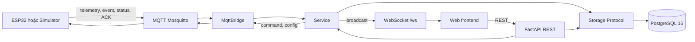
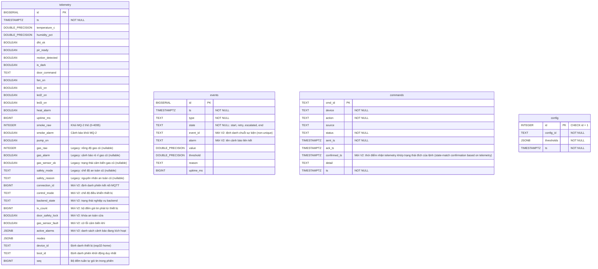

# Thiết kế cơ sở dữ liệu – phần Database & History

## 1. Phạm vi và nguồn đối chiếu

Tài liệu này mô tả thiết kế đang có trong mã nguồn, chủ yếu dựa trên:

- `backend/app/pg_storage.py`: hằng `SCHEMA`, lớp `PostgresStorage` và các câu SQL đọc/ghi;
- `backend/app/storage.py`: `Storage`, `InMemoryStorage`, danh sách metric và validation lịch sử;
- `backend/app/models.py`: mô hình dữ liệu nhận từ MQTT và validation nghiệp vụ;
- `backend/app/service.py`: lớp `Service`, nơi gắn thời gian nhận và gọi Storage;
- `backend/app/mqtt_bridge.py`, `backend/app/api.py`, `backend/app/main.py`: đường đi MQTT, REST và WebSocket;
- `docker-compose.yml`: PostgreSQL 16 và volume `pgdata`.

Các mục ghi “đề xuất” chưa phải là chức năng đã triển khai.

## 2. Kiến trúc dữ liệu hiện tại



Luồng nhận dữ liệu cụ thể:

1. `MqttBridge.handle_message()` định tuyến topic đến `Service.on_telemetry()`, `on_event()`, `on_status()`, `on_cmd_ack()` hoặc `on_config_ack()`.
2. `Service.on_telemetry()` và `Service.on_event()` kiểm tra payload bằng model Pydantic, lấy thời gian nhận từ `clock()` rồi gọi `save_telemetry()` hoặc `save_event()`.
3. Khi có `BTL_DATABASE_URL`, `backend/app/main.py` tạo `PostgresStorage`; nếu không có, hệ thống dùng `InMemoryStorage`.
4. `PostgresStorage` đổi Unix timestamp giây sang `TIMESTAMPTZ` bằng `to_timestamp()` khi ghi và đổi ngược bằng `extract(epoch from ...)::float8` khi đọc.
5. API hiện hành đọc lịch sử qua `Storage.history()` tại `GET /api/history`. Telemetry và các thay đổi trạng thái khác còn được `Service` phát trực tiếp qua WebSocket.

### Dữ liệu lưu bền và trạng thái runtime

| Luồng | Dữ liệu được lưu trong PostgreSQL | Phần chỉ tồn tại ở runtime |
|---|---|---|
| Telemetry MQTT | Một hàng `telemetry` cho mỗi payload hợp lệ; gồm cảm biến, trạng thái thiết bị, `modes`, `uptime_ms` và `ts` do backend gắn | Telemetry mới nhất trong `Service._telemetry` và trạng thái kết nối hiện hành |
| Event MQTT | Mỗi payload event hợp lệ thành một hàng `events`; `state` là `start` hoặc `end` | Không có trạng thái event tổng hợp riêng trong Service |
| Command và command ACK | Lệnh được ghi `pending` trước khi publish; ACK hoặc timeout cập nhật chính hàng `commands` qua `status`, `detail`, `ack_ts` | Không có hàng ACK riêng |
| Config và config ACK | Bảng `config` chỉ lưu `config_id`, `thresholds`, `ts` của cấu hình mới nhất | `pending`, `applied`, `rejected`, `timeout`, `detail` và thời điểm chờ ACK nằm trong `Service._config` |
| MQTT status/timeout kết nối | Không có bảng hoặc cột lưu online/offline | `_online`, `_last_seen`, `_offline_since`; được phát qua WebSocket |

Vì vậy “đã nhận ACK” không đồng nghĩa mọi loại ACK đều được lưu giống nhau: command ACK làm thay đổi hàng `commands`, còn config ACK chỉ thay đổi trạng thái runtime. Event là bản tin nghiệp vụ độc lập, không phải ACK.

## 3. ERD vật lý hiện tại

Schema được khai báo trong `backend/app/pg_storage.py` tại hằng `SCHEMA`. Bốn bảng không có khóa ngoại và không có quan hệ vật lý được khai báo. Vì vậy ERD dưới đây chỉ biểu diễn cấu trúc từng bảng, không vẽ quan hệ suy diễn.



### Chỉ mục và constraint

| Bảng | Khóa/constraint | Chỉ mục tường minh |
|---|---|---|
| `telemetry` | `PRIMARY KEY (id)`; `ts NOT NULL`; Partial Unique Constraint: `(device_id, boot_id, seq)` khi các trường `NOT NULL` | `telemetry_ts_idx (ts)`; `telemetry_dedup_idx UNIQUE (device_id, boot_id, seq) WHERE device_id IS NOT NULL AND boot_id IS NOT NULL AND seq IS NOT NULL`; `telemetry_device_boot_seq_idx (device_id, boot_id, seq)`; `telemetry_device_boot_conn_idx (device_id, boot_id, connection_id)` |
| `events` | `PRIMARY KEY (id)`; `ts`, `type`, `state` là `NOT NULL` | `events_ts_idx (ts)`; `events_type_ts_idx (type, ts)`; `events_event_id_idx (event_id) WHERE event_id IS NOT NULL` |
| `commands` | `PRIMARY KEY (cmd_id)`; `device`, `action`, `status`, `sent_ts`, `ts` là `NOT NULL` | `commands_sent_idx (sent_ts)`; `commands_status_idx (status)` |
| `config` | `PRIMARY KEY (id)`; `CHECK (id = 1)`; `config_id`, `thresholds`, `ts` là `NOT NULL` | Không có chỉ mục tường minh ngoài chỉ mục do PK tạo |

PostgreSQL tự tạo chỉ mục duy nhất để thực thi `PRIMARY KEY`; bảng không có `UNIQUE`, `FOREIGN KEY` hay `CHECK` nào khác trong source hiện tại.

## 4. Khởi tạo và lưu bền

`PostgresStorage.__init__()` mở `ConnectionPool` với `autocommit=True`, chờ database sẵn sàng rồi thực thi toàn bộ `SCHEMA`. Các lệnh đều dùng `CREATE TABLE IF NOT EXISTS` và `CREATE INDEX IF NOT EXISTS`; source không có migration versioned.

Trong Docker Compose, service `db` dùng image `postgres:16` và mount named volume:

```text
pgdata:/var/lib/postgresql/data
```

Do đó dữ liệu PostgreSQL nằm trong volume `pgdata`, tách khỏi vòng đời process/backend và writable layer của container. `docker restart` hoặc `docker compose down` rồi `up` không kèm `-v` không có chủ đích xóa named volume. `docker compose down -v`, xóa volume hoặc thao tác SQL phá hủy dữ liệu nằm ngoài quy trình an toàn của dự án.

## 5. Lựa chọn biểu diễn dữ liệu

### Timestamp

- Biên Storage nhận/trả thời gian dưới dạng Unix timestamp giây (`float` hoặc số tương thích).
- `Service` gắn `ts` bằng đồng hồ backend tại thời điểm nhận telemetry/event; đây không phải timestamp do thiết bị gửi.
- `uptime_ms` được lưu riêng từ payload thiết bị, không thay thế timestamp nhận.
- PostgreSQL lưu `TIMESTAMPTZ`, giúp biểu diễn thời điểm tuyệt đối; các truy vấn trả epoch giây để giữ contract backend.
- Bộ lọc của `history_page()`, `history_stats()` và `history_csv()` dùng biên `start`/`end` bao gồm cả hai đầu.

### JSONB

- `telemetry.modes` lưu map chế độ thiết bị từ telemetry. `PostgresStorage.save_telemetry()` ghi `{}` nếu giá trị này thiếu hoặc falsy.
- `config.thresholds` lưu trọn bộ ngưỡng. Bảng `config` chỉ giữ một hàng `id = 1`; `save_config()` dùng upsert để thay cấu hình hiện hành.
- JSONB cho phép lưu hai cấu trúc dạng object này mà không cần tách trường thành các cột riêng. Source hiện tại luôn đọc/ghi cả object, chưa khai báo JSON schema hay chỉ mục GIN ở tầng database; validation ngưỡng nằm trong `models.Thresholds`.

### Chỉ mục

- `telemetry_ts_idx` phục vụ lọc và sắp xếp lịch sử theo `ts`.
- `events_ts_idx` hỗ trợ truy vấn sự kiện mới nhất theo thời gian.
- `commands_sent_idx` hỗ trợ danh sách lệnh theo `sent_ts DESC`.
- CSV sắp xếp theo `(ts, id)`, nhưng schema hiện chỉ có chỉ mục đơn trên `ts`; chưa có chỉ mục ghép `(ts, id)`.

## 6. Truy vấn lịch sử

### `history()` – contract API cũ

`Storage.history(metric, start, end)` trả `[{"ts": ..., "value": ...}]` và bỏ các hàng có giá trị metric là `NULL`. API hiện có `GET /api/history` chỉ gọi method này. Không thay đổi contract này trong các nhiệm vụ lịch sử mới.

### `history_page()` – phân trang OFFSET

- Validation dùng allowlist 15 metric, `limit` là số nguyên từ 1 đến 1000, `offset` là số nguyên không âm; timestamp phải hữu hạn và `start <= end`.
- PostgreSQL áp dụng `ORDER BY ts, id LIMIT %s OFFSET %s` ngay trong SQL. `limit` và `offset` được bind bằng tham số.
- `id` tạo thứ tự ổn định cho các hàng trùng timestamp. `InMemoryStorage` dùng thứ tự ghi làm khóa phụ tương đương.
- OFFSET dễ tích hợp nhưng chi phí tăng khi offset lớn và kết quả có thể dịch chuyển nếu dữ liệu thay đổi giữa các lần gọi.

### `history_stats()` – thống kê

- Hỗ trợ 4 metric số: `temperature_c`, `humidity_pct`, `smoke_raw`, `gas_raw`.
- Trả `count: int` và `avg`, `min`, `max` là `float | None`.
- `NULL`, `NaN`, `Infinity`, `-Infinity` không tham gia thống kê. Với `smoke_raw` và `gas_raw` kiểu `INTEGER`, PostgreSQL không thể lưu các giá trị không hữu hạn; predicate tương ứng là hằng `TRUE` sau kiểm tra `IS NOT NULL`.
- Tên cột và predicate lấy từ allowlist/hằng `HISTORY_STATS_SQL`, không lấy trực tiếp chuỗi chưa kiểm tra từ người gọi.

### `history_csv()` – xuất CSV theo keyset

- Validation chạy khi gọi method, trước khi iterator được trả về.
- PostgreSQL chốt `max(id)` làm high-water. Mọi batch chỉ xét `id <= snapshot_id`, vì vậy các insert có ID mới hơn sau thời điểm chốt không được đưa vào export.
- Các batch dùng điều kiện keyset `(ts, id) > (cursor_ts, cursor_id)`, `ORDER BY ts, id` và `LIMIT` bind bằng tham số; không tải toàn bộ lịch sử vào RAM.
- `csv.writer` sinh CSV UTF-8, header `ts,value`, CRLF và escaping chuẩn. Boolean hiện được biểu diễn `True`/`False`.
- `InMemoryStorage` chụp snapshot có giới hạn O(n). Đây là lựa chọn chấp nhận được vì deque telemetry bị giới hạn bởi `max_telemetry`.

High-water ID không phải MVCC snapshot của toàn bộ phiên export. Mỗi batch PostgreSQL chạy trong một transaction autocommit riêng. Thiết kế hiện tại phù hợp đường ghi append-only qua `save_telemetry()`, nhưng không cam kết một snapshot transaction tuyệt đối nếu có thao tác SQL ngoài Storage cập nhật hàng cũ hoặc một transaction đồng thời cấp ID trước rồi commit muộn.

## 7. Thiết kế hiện tại và cải tiến đã thực hiện

| Chủ đề | Trước cải tiến | Hiện tại sau cải tiến (Đã hoàn thành & Đạt 239 tests) |
|---|---|---|
| Schema Migration | Tự tạo bằng `CREATE ... IF NOT EXISTS` | Idempotent `ALTER TABLE telemetry ADD COLUMN IF NOT EXISTS` cho `device_id`, `boot_id`, `seq`, `gas_raw`, `gas_alarm`, `gas_sensor_ok`, `safety_mode`, `safety_reason` an toàn 100% |
| Chống trùng (Deduplication) | Không có cơ chế chống trùng telemetry | Partial Unique Index `telemetry_dedup_idx (device_id, boot_id, seq)` loại trừ NULL, kết hợp `ON CONFLICT DO NOTHING` và `ReliabilityTracker` |
| Định danh Telemetry | Chỉ có timestamp `ts` và `uptime_ms` | Bộ ba định danh `(device_id, boot_id, seq)`; tương thích ngược hoàn toàn với dữ liệu legacy (`None`/`NULL`) |
| Xử lý Out-of-order | Ghi đè trạng thái `_telemetry` bất kể thứ tự | Nhận diện late arrival, lưu vào DB lịch sử nhưng KHÔNG ghi đè trạng thái mới nhất `_telemetry` |
| Sequence Gap & Trễ | Không phát hiện được mất gói | Interval-based Pending Gaps, không OOM khi gap cực lớn (50,000 hay 100,000,000 gói); theo dõi cửa sổ trễ `late_window_s = 10s` |
| Giới hạn bộ nhớ & Thread-safe | Không giới hạn RAM, không lock | Sliding window trần 5,000 seq, Ring buffer 1,000 sự kiện, LRU 500 sessions; bảo vệ bằng RLock toàn diện |
| Độ bền Realtime khi DB lỗi | DB lỗi làm sập toàn bộ luồng nhận | Bắt lỗi lưu trữ, phân tách received/displayed/persisted, giữ nhịp tim realtime hiển thị trên web |
| Cảm biến Gas & An toàn | Chưa có cột gas trong DB | Đã mở rộng 5 trường gas/safety, kiểm thử phân trang, CSV streaming, stats và event history hoàn tất |
| Kiểm chứng độ tin cậy | Không có chỉ số kiểm chứng | Cung cấp `reliability_stats()` và hàm SQL Window `verify_telemetry_gaps()` kiểm chứng trực tiếp trên PostgreSQL |
| Thống kê lệnh | Không có thống kê tổng hợp | Cung cấp `command_stats()` đo đếm ok, failed, timeout, pending, success_rate, min/avg/max duration |
| Lịch sử Online/Offline & Lỗi | Chỉ có WebSocket runtime, không lưu DB | Tận dụng bảng `events`: `save_connection_event()`, `list_connection_events()`, `list_error_events()` (hỗ trợ cả `gas_alarm`, `gas_error`) |

## 8. Thiết kế Module Reliability & Data Quality (Phục vụ bài báo khoa học)

Hệ thống IoT Smart Home Digital Twin đòi hỏi dữ liệu đo lường thời gian thực từ cảm biến phải đảm bảo tính toàn vẹn, đúng thứ tự và không bị trùng lặp.

### 8.1. Mô hình định danh và phân loại bản tin

Mỗi bản tin telemetry được phát ra từ thiết bị được định danh bằng bộ ba:
$$\text{MsgId} = (\text{device\_id}, \text{boot\_id}, \text{seq})$$
- `device_id`: Định danh phần cứng thiết bị (ví dụ: `esp32-home`).
- `boot_id`: Định danh duy nhất cho một chu kỳ nguồn/khởi động của thiết bị (UUID hoặc chuỗi timestamp khởi động).
- `seq`: Số nguyên tăng dần đơn điệu $seq \in \{0, 1, 2, \dots\}$ trong suốt một phiên khởi động, reset về 0 khi reboot.

Các trường hợp bản tin đến backend được phân loại theo tập quy tắc:
1. **Bản tin hợp lệ, đúng thứ tự (In-Order)**: $seq = seq_{max} + 1$.
2. **Bản tin trùng lặp (Duplicate)**: Bản tin có $(\text{device\_id}, \text{boot\_id}, seq)$ đã tồn tại trong hệ thống. Xảy ra do cơ chế truyền lại QoS 1 của MQTT hoặc biến động kết nối WiFi.
3. **Bản tin đến muộn / lệch thứ tự (Out-of-order / Late Arrival)**: $seq < seq_{max}$ trong cùng một `boot_id` và chưa từng xuất hiện trước đó.
4. **Đứt đoạn chuỗi (Sequence Gap)**: $seq > seq_{max} + 1$. Các số thứ tự nằm trong khoảng $[seq_{max} + 1, seq - 1]$ được xác định là đang bị khuyết.
5. **Khởi động lại (Reboot / Sequence Reset)**: Khi `boot_id` thay đổi, hệ thống mở một phiên theo dõi mới; việc `seq` bắt đầu lại từ 0 được chấp nhận là phiên mới, không bị nhầm lẫn với duplicate của phiên cũ.

### 8.2. Cơ chế Cửa sổ quan sát (Observation Window) và Phân loại Gap

Một trong những sai lầm kinh điển khi đánh giá độ tin cậy mạng IoT không dây là xem sự đứt đoạn chuỗi tức thời là mất gói vĩnh viễn (permanent packet loss). Trong thực tế, các gói tin MQTT qua TCP/IP và sóng WiFi có thể bị trễ hàng đợi (jitter) hoặc đến lệch thứ tự sau khoảng thời gian lớn.

Hệ thống triển khai cửa sổ quan sát trễ $T_{\text{late}} = 10.0\,\text{giây}$:
- Tại thời điểm phát hiện gap $t_{\text{detect}}$, các gói khuyết được đưa vào trạng thái **Pending Gaps** (đang chờ trong cửa sổ quan sát):
  $$\text{Gap}_{\text{pending}} = \{ seq_m \mid t_{\text{current}} - t_{\text{detect}} \le T_{\text{late}} \}$$
- Nếu một gói $seq_m$ đến trước khi hết hạn $T_{\text{late}}$: gap được bù đắp thành công, gói được ghi nhận là `out_of_order` (late arrival).
- Khi $t_{\text{current}} - t_{\text{detect}} > T_{\text{late}}$ mà gói chưa xuất hiện, gói được phân loại là **Unresolved Gaps Beyond Observation Window** (gap chưa được giải quyết ngoài cửa sổ trễ quan sát):
  $$\text{Gap}_{\text{unresolved}} = \{ seq_m \mid t_{\text{current}} - t_{\text{detect}} > T_{\text{late}} \}$$
- **Nguyên tắc đối soát**: Hệ thống KHÔNG coi các gói này là "mất vĩnh viễn không thể hồi phục". Nếu gói tin đến muộn sau 15–20 giây (ngoài $T_{\text{late}}$), hệ thống vẫn ghi nhận là late arrival hợp lệ, lưu vào cơ sở dữ liệu và trừ đi số gap chưa giải quyết, bảo đảm tính khoa học và khả năng đối soát chính xác.

### 8.3. Nguyên tắc bảo vệ trạng thái hiện tại (State Protection)

Trong mô hình Digital Twin, trạng thái tức thời `Service._telemetry` điều khiển giao diện web và các quyết định tự động.
**Nguyên tắc**: Bản tin cũ đến muộn ($seq < seq_{max}$) vẫn được lưu vào cơ sở dữ liệu lịch sử phục vụ phân tích hồi cứu (analytics), nhưng **tuyệt đối không được ghi đè** lên trạng thái hiện tại `Service._telemetry`.

### 8.4. Công thức toán học và kiểm chứng trực tiếp bằng SQL

#### Phân biệt các đại lượng đo lường:
- $tx\_attempted\_count$ ($N_{\text{attempt}}$): Tổng số lần thiết bị chuẩn bị phát bản tin (lấy từ $\max(tx\_count)$ theo từng phiên boot $\sum_{\text{sessions}} \max(tx\_count)$). Nếu không có $tx\_count$, giá trị là `None`.
- $received\_unique$ ($N_{\text{recv\_uniq}}$): Số bản tin duy nhất đã nhận được (không tính các bản tin duplicate).
- $stored\_unique$ / $stored\_count$ ($N_{\text{stored}}$): Tổng số bản tin hợp lệ được lưu bền trong PostgreSQL.
- $N_{\text{dup}}$: Số bản tin trùng lặp phát hiện được.
- **Tỷ lệ phân phối quan sát được (Observed Delivery Rate)**:
  $$R_{\text{delivery}} = \frac{N_{\text{recv\_uniq}}}{N_{\text{attempt}}} = \frac{received\_unique}{tx\_attempted\_count}$$
  Hệ thống tính $R_{\text{delivery}}$ chính xác theo session `(device_id, boot_id)`, không bị ảnh hưởng bởi bản tin duplicate, không clamp giả định $100\%$, và trả về `None` kèm ghi chú giải thích nếu phát hiện bất thường ($N_{\text{recv\_uniq}} > N_{\text{attempt}}$).
- **Tỷ lệ lưu trữ bền vững (Storage Rate)**:
  $$R_{\text{storage}} = \frac{N_{\text{stored}}}{N_{\text{attempt}}} = \frac{stored\_unique}{tx\_attempted\_count}$$

#### Truy vấn SQL kiểm chứng Sequence Gap bằng Window Function:
Câu truy vấn sau được sử dụng trong bài báo để kiểm chứng độc lập tính liên tục của dữ liệu đã lưu trong PostgreSQL:
```sql
WITH seq_diffs AS (
    SELECT
        device_id,
        boot_id,
        seq,
        lag(seq) OVER (PARTITION BY device_id, boot_id ORDER BY seq) AS prev_seq
    FROM telemetry
    WHERE device_id = %s AND boot_id = %s AND seq IS NOT NULL
)
SELECT
    prev_seq + 1 AS gap_start,
    seq - 1 AS gap_end,
    (seq - prev_seq - 1)::bigint AS missing_count
FROM seq_diffs
WHERE prev_seq IS NOT NULL AND seq > prev_seq + 1
ORDER BY gap_start;
```
- Nếu tập kết quả rỗng: chuỗi dữ liệu trong phiên boot đạt tính toàn vẹn 100% không khuyết.
- Nếu tập kết quả có hàng: chỉ rõ khoảng gap $[gap\_start, gap\_end]$ và số lượng gói bị mất.

### 8.5. Thống kê lệnh điều khiển (Command Reliability)

Thời gian đáp ứng của lệnh điều khiển thiết bị:
$$\Delta T_{\text{ack}, i} = T_{\text{ack}, i} - T_{\text{sent}, i} \quad (\text{với các lệnh có trạng thái } ok \text{ hoặc } failed)$$
Thời gian xác nhận khớp trạng thái đích từ telemetry (state-match confirmation based on telemetry):
$$\Delta T_{\text{confirm}, i} = T_{\text{confirmed}, i} - T_{\text{sent}, i} \quad (\text{với các lệnh có } confirmed\_ts)$$
Chỉ số độ tin cậy lệnh:
$$R_{\text{command}} = \frac{N_{ok}}{N_{\text{total}}}$$
Thời gian trễ xác nhận trung bình, nhỏ nhất, lớn nhất:
$$\overline{\Delta T_{\text{confirm}}} = \frac{1}{K} \sum_{i=1}^K \Delta T_{\text{confirm}, i}, \quad \min(\Delta T_{\text{confirm}, i}), \quad \max(\Delta T_{\text{confirm}, i})$$
Triển khai bằng SQL tổng hợp tối ưu trên bảng `commands` qua method `storage.command_stats()`.

### 8.6. Tính ổn định, An toàn luồng và Giới hạn bộ nhớ (Production-Ready Architecture)

1. **Giới hạn bộ nhớ (Bounded Memory & Sliding Window)**:
   - Thay vì lưu trữ vô hạn các sequence đã thấy trong RAM dẫn đến rò rỉ bộ nhớ (OOM) khi hệ thống chạy dài ngày, `ReliabilityTracker` áp dụng sliding window giới hạn $W = 5{,}000$ sequence gần nhất cho mỗi session bằng cấu trúc kết hợp `set` và FIFO `deque`.
   - Danh sách sự kiện gap `_gap_events` được giới hạn bằng Ring Buffer `deque(maxlen=1000)`. Tổng số gap trong suốt vòng đời được bảo toàn trong biến tích lũy `_total_gap_events_count`.
   - Các sequence gap được quản lý theo mô hình **Interval-based** `[start_seq, end_seq, detected_at]`, tiêu thụ bộ nhớ cố định $O(k)$ với $k$ là số khoảng rời rạc (kể cả khi khoảng gap lên tới hàng triệu sequence).
   - Quản lý phiên hoạt động theo cơ chế **LRU Session Eviction** với trần tối đa 500 boot sessions đồng thời. Khi vượt ngưỡng, session cũ nhất bị evict, toàn bộ gap intervals của session đó được dọn sạch khỏi RAM và missing packets được kết chuyển an toàn sang bộ đếm `unresolved_beyond_window`.
   - **Bảo toàn tỷ lệ khi Eviction**: Giá trị `tx_attempted` và `received_unique` của session bị evict được tích lũy vào `_evicted_tx_attempted_*` và `_evicted_received_unique_*` để tỷ lệ $delivery\_rate$ và $storage\_rate$ không bị trôi lệch khi giải phóng RAM.
   - **Nhất quán sau Restart**: Sau khi backend khởi động lại, `_init_tracker_sessions` chỉ nạp `max_seq` và `max_tx_count` từ PostgreSQL để chống duplicate / out-of-order, tuyệt đối không gán $received\_unique = stored\_count$. Với các session được phục hồi sau restart, $delivery\_rate$ trả về `null` kèm ghi chú hạn chế, trong khi $storage\_rate = stored\_unique / tx\_attempted\_count$ vẫn đo lường độ tin cậy lưu bền chính xác.
   - Áp dụng cơ chế **Hard Cap cưỡng chế** cho `_pending_gap_intervals` (mặc định 1.000 intervals) để chống bão phân mảnh (fragmentation) khi nhận nhiều bản tin đến muộn xen kẽ trong thời gian ngắn.

2. **An toàn đa luồng (Thread-Safety)**:
   - Toàn bộ các thao tác ghi nhận và tổng hợp chỉ số trong `ReliabilityTracker` được bảo vệ bằng `threading.RLock()`.
   - Đảm bảo an toàn đa luồng (thread-safety) khi `PostgresStorage` sử dụng ConnectionPool đa luồng xử lý đồng thời nhiều bản tin MQTT.

3. **Tính nhất quán sau Restart & Chống đếm đúp (Restart Consistency)**:
   - Sau khi backend khởi động lại, `_session_max_seq` được phục hồi từ PostgreSQL (`SELECT device_id, boot_id, max(seq)`), trong khi `seen_seqs` trong RAM ban đầu rỗng.
   - Nếu nhận lại một bản tin cũ $seq < max\_seq$ đã được lưu trước khi restart, `record_incoming` ban đầu nghi ngờ là out-of-order. Khi PostgreSQL trả về xung đột vi phạm partial unique index (`ON CONFLICT DO NOTHING`), method nghiệp vụ `record_db_duplicate(..., was_out_of_order=True)` sẽ ghi nhận bản tin trùng và triệt tiêu bộ đếm out-of-order, ngăn chặn lỗi đếm đúp.
   - Khi nhận bản tin có $seq == max\_seq$ sau khi restart, tracker lập tức phân loại là duplicate, không sinh gap event giả mạo (`count=0`).
   - Nếu transaction ghi database thất bại, `revert_incoming()` hoàn lại các biến đếm tracker, giữ trạng thái RAM luôn đồng bộ với dữ liệu đã commit trong DB.

4. **Phân tách luồng Realtime và Persistence khi DB lỗi**:
   - `Service.on_telemetry()` phân biệt rõ 3 tầng: `received` (tầng mạng), `persisted` (tầng lưu trữ PostgreSQL) và `displayed` (tầng giám sát thời gian thực).
   - Ngoại lệ lưu trữ từ DB được bắt và log cảnh báo rõ ràng; trạng thái hiển thị tức thời `_telemetry`, cờ kết nối `_online` và broadcast WebSocket vẫn duy trì bình thường để người dùng không bị mất nhịp tim giám sát nhà thông minh khi PostgreSQL gặp sự cố tạm thời.
   - Bản tin trùng lặp (duplicate) hoặc bản tin đến muộn (out-of-order) không ghi đè trạng thái realtime mới nhất.
